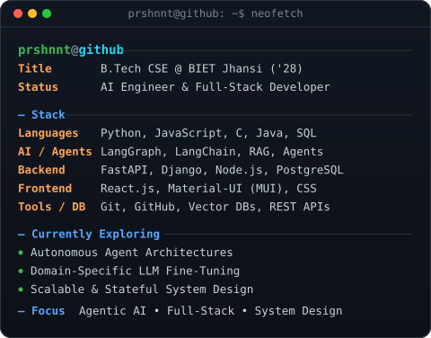

# <picture></picture> Prashant Singh

 

 

<table border="1" cellpadding="14" cellspacing="0">
<tr>

<td align="center" valign="middle" width="460">

</td>

<td align="center" valign="middle" width="610">

</td>

</tr>
</table>

---

## 👨‍💻 About Me

Computer Science Engineering student at **Bundelkhand Institute of Engineering and Technology (BIET), Jhansi** (*Expected 2028*), with demonstrated expertise in **full-stack software engineering** and **AI application design**.

- 🤖 **Agentic AI & LLMs:** Hands-on experience engineering autonomous multi-agent workflows, domain-specific prompt engineering, fine-tuning, and robust RAG pipelines.
- ⚡ **Full-Stack Craftsmanship:** Architecting scalable backends using **Python** (FastAPI, Django) and **Node.js**, paired with responsive modern frontends in **React.js**.
- 📐 **Engineering Rigor:** Strong foundation in Data Structures, Algorithms, System Design, RESTful API design, and SQL/vector databases.
- 🎯 **Leadership & Innovation:** National-level hackathon finalist (Smart India Hackathon) and Gold Medal Winner at COSCO Synergia.

---

## 🛠️ Tech Stack & Skills

### 💻 Languages

### 🤖 AI, LLMs & Agentic Systems

### ⚙️ Frameworks & Backend

### 🧰 Tools & Libraries

---

## 🚀 Featured Projects

<table>
  <tr>
    <td width="50%" valign="top">
      <h3>🤖 AgenticAI — Intelligent Autonomous Framework</h3>
      

        An autonomous multi-agent reasoning framework engineered with <b>JavaScript / Node.js</b>.
      

      <ul>
        <li>Implemented state management paradigms and API routing blocks for iterative reasoning loops.</li>
        <li>Dynamic runtime tool execution hooks allowing LLMs to parse user intent and trigger real-time actions.</li>
        <li>Decoupled orchestration logic from execution components for clean extensibility.</li>
      </ul>
      
<b>Stack:</b> Node.js, JavaScript, LLM Orchestration, RESTful APIs

    </td>
    <td width="50%" valign="top">
      <h3>⚖️ LegalGPT — Domain-Specific AI Legal Assistant</h3>
      

        An intelligent AI assistant specialized in legal document intelligence and contract risk evaluation.
      

      <ul>
        <li>Custom prompt engineering and specialized chunking strategies for dense statutory legal codes.</li>
        <li>High-accuracy RAG pipeline with citations directly mapped to original statutory documents.</li>
        <li>Secure frontend allowing users to upload documents and pinpoint liability clauses.</li>
      </ul>
      
<b>Stack:</b> Python, RAG, Vector DB, Prompt Engineering, React.js

    </td>
  </tr>
  <tr>
    <td width="50%" valign="top">
      <h3>📝 Blogizer — Full-Stack Blogging Platform</h3>
      

        A feature-rich blogging application built for seamless authoring and community interaction.
      

      <ul>
        <li>Secure user authentication, full post lifecycle management, and threaded commenting.</li>
        <li>Dynamic content rendering powered by a high-throughput RESTful API.</li>
        <li>Fully responsive, modern user experience across devices.</li>
      </ul>
      
<b>Stack:</b> Python, React.js, REST API, PostgreSQL

    </td>
    <td width="50%" valign="top">
      <h3>🇮🇳 Smart India Hackathon Project</h3>
      

        National-level hackathon solution addressing real-world problem statements at scale.
      

      <ul>
        <li>Rapid prototyping with Python frameworks and modern web technologies.</li>
        <li>Scalable data management system with sub-second query processing and data visualization.</li>
        <li>Engineered within a collaborative, fast-paced agile development sprint.</li>
      </ul>
      
<b>Stack:</b> Python, Web Technologies, Data Visualization, Agile

    </td>
  </tr>
</table>

---

## 🏆 Achievements & Leadership

- 🥇 **Gold Medal Winner** — *Synergia Competition* at COSCO event (demonstrated technical excellence and innovation).
- 🧭 **Green House Captain** — *St. Mark's School* (led team initiatives and fostered collaborative culture).
- 🏸 **Additional Interests:** Badminton, Sketching & Creative Arts, AI Systems Architecture, Open Source Contribution.

---

## 📊 GitHub Stats

---

## 🐍 Snake Eating Contributions

<picture>
  <source media="(prefers-color-scheme: dark)" srcset="https://raw.githubusercontent.com/prshnnt/prshnnt/output/github-snake-dark.svg">
  <source media="(prefers-color-scheme: light)" srcset="https://raw.githubusercontent.com/prshnnt/prshnnt/output/github-snake-light.svg">
  
</picture>

---

### 👀 Profile Views

 

### 🤝 Let's Connect!
[LinkedIn](https://www.linkedin.com/in/prashant-singh-0263622b3/) • [GitHub](https://github.com/prshnnt) • [Email](mailto:prshnnt@gmail.com)

**⭐ Thanks for visiting my profile!**

